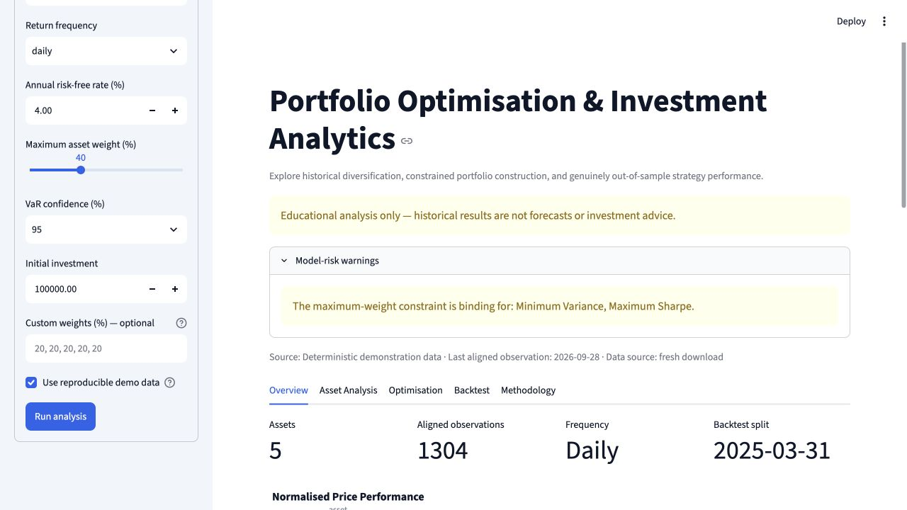
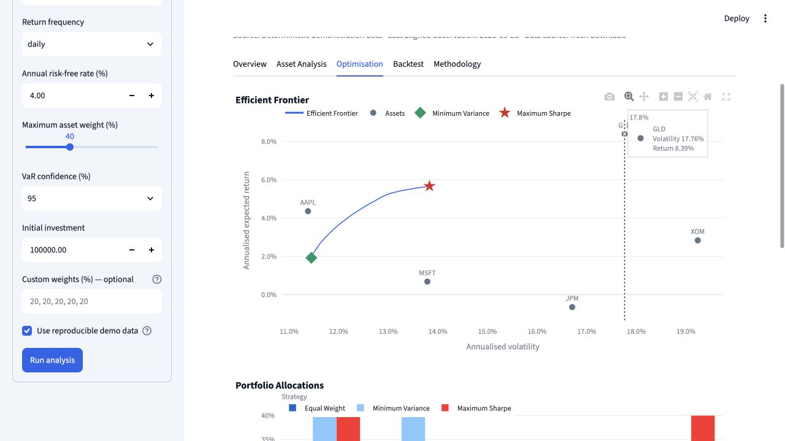
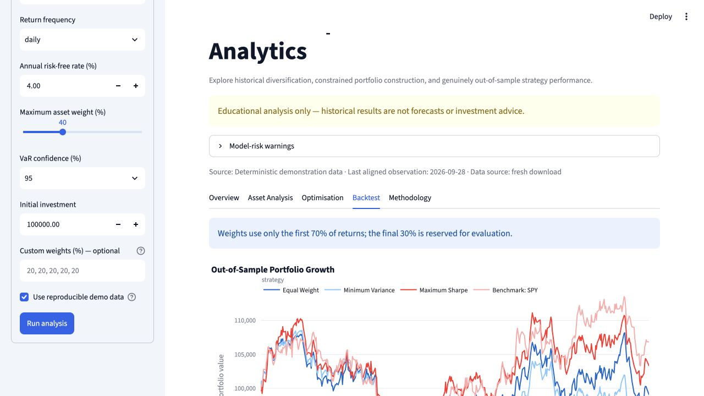

# Portfolio Optimisation & Investment Analytics Dashboard

An interactive investment-analysis application that transforms historical prices
into risk analytics, constrained portfolio allocations, an efficient frontier, and
a chronological out-of-sample strategy comparison.

The project demonstrates quantitative finance, model validation, Python software
engineering, and clear investment communication. It is designed as a portfolio
project for investment-management and MSc Finance applications.

## What the application does

- Analyses 3–10 selected assets and a benchmark
- Calculates annualised return, volatility, Sharpe, Sortino, beta, drawdown,
  historical VaR, and Expected Shortfall
- Builds long-only minimum-variance and maximum-Sharpe portfolios
- Enforces full investment and a configurable maximum asset weight
- Generates the non-dominated efficient frontier
- Compares equal-weight, optimised, and optional custom portfolios
- Separates estimation and evaluation using a chronological 70/30 split
- Displays interactive Plotly charts through a five-section Streamlit dashboard
- Provides deterministic demo data for reproducible offline review

## Why the backtest is credible

Portfolio weights are estimated only from the first 70% of return observations.
The final 30% is not visible to the optimiser and is used exclusively for evaluation.
A regression test changes future prices and verifies that fitted weights do not
move, directly testing the absence of look-ahead leakage.

## Quick start

Python 3.10 or newer is supported; Python 3.11 is recommended.

```bash
python3 -m venv .venv
source .venv/bin/activate
python -m pip install --upgrade pip
python -m pip install -r requirements.txt
streamlit run app.py
```

Select **Run analysis** with **Use reproducible demo data** enabled to reproduce the
included case study without network access. Disable demo mode to request adjusted
prices from Yahoo Finance.



## Dashboard

| Section | Contents |
|---|---|
| Overview | Normalised prices, cumulative performance, dataset summary |
| Asset Analysis | Risk table, correlation heatmap, drawdown histories |
| Optimisation | Efficient frontier, optimal allocations, in-sample comparison |
| Backtest | Out-of-sample growth, drawdowns, realised performance table |
| Methodology | Assumptions, exclusions, limitations, disclaimer |





## Demonstration finding

In the reproducible five-asset case, the minimum-variance portfolio achieved the
lowest out-of-sample volatility, while the maximum-Sharpe portfolio produced the
strongest return among the constructed strategies. Neither optimised portfolio
dominated the synthetic benchmark across return and risk measures. See the
[complete case study](docs/portfolio_case_study.md).

## Architecture

```text
Market data → aligned prices → returns → risk analytics
                                   ├→ optimisation → strategy comparison
                                   └→ 70/30 backtest → realised analytics
                                                       ↓
                                              Streamlit + Plotly
```

Core modules live under `src/portfolio_analytics/` and keep data retrieval,
financial calculations, optimisation, backtesting, safeguards, and presentation
separate. The Streamlit entry point is `app.py`.

## Quality controls

```bash
python -m pip install -r requirements-dev.txt
pytest
ruff check .
pytest --cov=portfolio_analytics --cov-report=term-missing
```

The suite includes closed-form optimiser benchmarks, hand-calculated risk cases,
constraint checks, data-quality failures, an end-to-end deterministic integration
test, leakage regression, and chart construction tests. The required coverage
threshold is 85%.

## Documentation

- [MVP scope](docs/mvp_scope.md)
- [Market-data layer](docs/data_layer.md)
- [Return calculations](docs/return_calculations.md)
- [Risk analytics](docs/risk_analytics.md)
- [Portfolio optimisation](docs/portfolio_optimisation.md)
- [Strategy comparison](docs/portfolio_comparison.md)
- [Backtesting](docs/backtesting.md)
- [Model validation](docs/model_validation.md)
- [Safeguards and disclosures](docs/safeguards_and_disclosures.md)
- [Dashboard guide](docs/streamlit_dashboard.md)
- [Deployment guide](docs/deployment.md)

## Limitations

Historical estimates are not forecasts. The MVP excludes transaction costs, taxes,
spreads, market impact, currency conversion, short selling, leverage, return
forecasting, and trade execution. Yahoo Finance is used only as an accessible
portfolio-project data source.

## Disclaimer

This application is for educational and analytical purposes only. Nothing it
produces should be interpreted as investment advice or a recommendation to buy or
sell a security.
